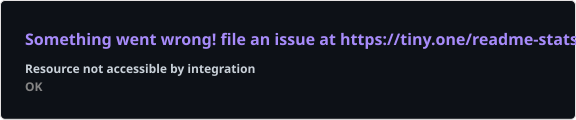

 

 

 

---

## About

**Software projects · Applied machine learning · AI tooling**

I'm Beatriz. My project portfolio includes Java applications, a collaborative MATLAB image-classification project, and an online library / bookstore application. I also run [Bea Destinations](https://beadestinations.com), where original photography and practical trip planning meet.

I care about what software helps people do: learn a subject, work with information, or make a clearer decision. CodeLearner connects programming education with application development; Cats-vs-Dogs explores image preprocessing and neural-network approaches.

My GitHub also includes forks of MCP servers, Hugging Face skills, and creative automation tools. These reflect the tools I'm exploring; the original maintainers retain credit for their work.

### Open to

Conversations about educational software, practical AI tools, and useful digital products. Explore the projects below or start a conversation through [this profile's issue tracker](https://github.com/beatrizcangas41/beatrizcangas41/issues).

---

## Tech stack

### Languages

### Application interfaces

### Backend & databases

### Development tooling

---

## AI / ML expertise

| Domain | Proficiency / evidence | Details |
| :--- | :--- | :--- |
| **Computer vision** | Academic project experience | Co-authored [Cats-vs-Dogs](https://github.com/beatrizcangas41/Cats-vs-Dogs), a MATLAB image-classification project. |
| **Deep learning** | Project-based exploration | Project documentation covers AlexNet and VGG16 tooling. |
| **Image preprocessing** | Implemented project functions | Repository includes preprocessing functions and a final solution script. |
| **Model evaluation** | Academic analysis | Project questions examine validation accuracy, dataset size, and classification behavior. |
| **MCP & agent tooling** | Exploration through forks | Forks include [LinkedIn MCP Server](https://github.com/beatrizcangas41/linkedin-mcp-server) and [Hugging Face Skills](https://github.com/beatrizcangas41/huggingface-skills); upstream authorship is distinct from my work. |

---

## Featured projects

<strong>01 · CodeLearner — educational Java application</strong>

 

A collaborative school project that introduces programming concepts through an interactive Java application. The repository is named CodeEditor; its README identifies the product as CodeLearner.

| Dimension | Details |
| :--- | :--- |
| **Stack** | Java, IntelliJ IDEA, Maven, MySQL; local database setup documented with WampServer and phpMyAdmin. |
| **Scale** | Academic application with learning modules, user records, and completion scores. |
| **Performance** | No production benchmark claimed; source and setup documentation are available for review. |
| **Security** | The historical README describes password protection and token-based password resets; this is documentation, not a current security certification. |
| **Impact** | Designed to make introductory STEM learning more accessible. |
| **Repository** | [Explore CodeLearner](https://github.com/beatrizcangas41/CodeEditor) |

**Engineering approach**

The project brings together an application interface, persistent user and course information, and a module-based learning flow. Its documented initial course covers C++ basics. Additional courses and a web version were proposed future work, rather than shipped capabilities.

 

<strong>02 · Cats-vs-Dogs — MATLAB machine learning project</strong>

 

An academic image-classification project co-authored with Efrem Yohannes-Mason, exploring preprocessing, neural-network models, and dataset selection.

| Dimension | Details |
| :--- | :--- |
| **Stack** | MATLAB, Deep Learning Toolbox, AlexNet and VGG16 model packages. |
| **Scale** | Uses the Kaggle Dogs vs. Cats dataset; the README contrasts a 40-image starter subset with the available 25,000-image training dataset. |
| **Performance** | Evaluation questions and a final report are included; no unverified accuracy result is claimed here. |
| **Security** | Academic local-analysis workflow; no production deployment or security audit claimed. |
| **Impact** | Demonstrates an end-to-end image-classification learning exercise with documented research questions. |
| **Repository** | [Explore Cats-vs-Dogs](https://github.com/beatrizcangas41/Cats-vs-Dogs) |

**Engineering approach**

The repository includes a final solution script, separate image-preprocessing functions, starter materials, and a final project report. The documented investigation considers training / validation splits, sample size, and model behavior.

 

<strong>03 · OwlLibrary — library / bookstore application</strong>

 

A Java project described in its repository as an online library / bookstore.

| Dimension | Details |
| :--- | :--- |
| **Stack** | Java, Maven project configuration, and an included SQL script. |
| **Scale** | Source repository with application code and setup instructions. |
| **Performance** | No public benchmark or deployment scale claimed. |
| **Security** | No current security validation claimed. |
| **Impact** | Explores a practical library / bookstore application domain. |
| **Repository** | [Explore OwlLibrary](https://github.com/beatrizcangas41/OwlLibrary) |

**Engineering approach**

The repository provides source code, instructions, a Maven configuration, and a database script. These materials are the basis for reviewing its implementation and setup.

---

## Experience

### Collaborative software projects

**Academic project portfolio**

Public repositories document work across educational applications, database-backed Java software, and machine learning.

- **Application development:** CodeLearner combines learning modules with persistent user and course information.
- **Machine learning collaboration:** Cats-vs-Dogs credits Beatriz Cangas-Perez and Efrem Yohannes-Mason as co-authors.
- **Data-oriented software:** OwlLibrary includes application source and an SQL script.
- **Technical documentation:** CodeLearner and Cats-vs-Dogs provide project descriptions and supporting setup or research materials.

---

## Achievements

| Recognition | Details |
| :---: | :---: |
| **Pull Shark** | [GitHub profile achievement](https://github.com/beatrizcangas41?achievement=pull-shark&tab=achievements). |
| **YOLO** | [GitHub profile achievement](https://github.com/beatrizcangas41?achievement=yolo&tab=achievements). |
| **Published project work** | Public Java application repositories and a co-authored MATLAB machine learning project. |

---

## GitHub analytics

 
 

---

## GitHub trophies

---

## Contribution activity

Public repository history is available through GitHub. Contribution visibility follows my profile privacy settings.

---

## Contribution snake

---

## Current focus

~~~yaml
Learning:
  - AI tools and agent workflows
  - Practical applications of machine learning

Building:
  - "Bea Destinations: original photography and useful trip planning"
  - A clearer portfolio of documented software projects

Exploring:
  - Model Context Protocol tools
  - Hugging Face skills and creative automation

Open To:
  - Conversations about educational software
  - Practical AI tooling and useful digital products
~~~

---

## Connect

**Explore a project, follow my work, or start a technical conversation.**

 

---

<em>Useful software starts with a clear purpose.</em>

 
 

